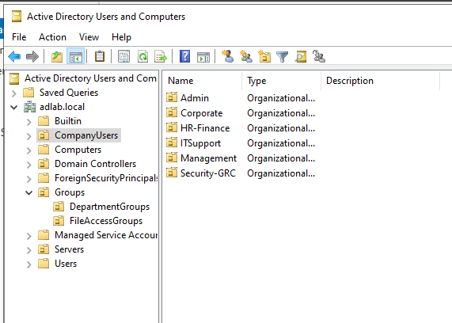
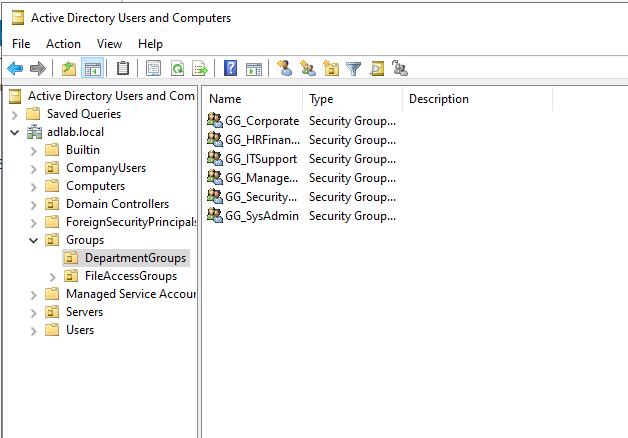
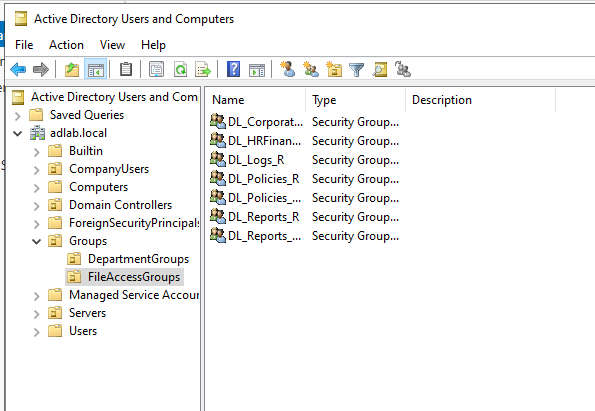

# Implementation

## Organizational Structure

The Organizational Unit structure was designed to separate users based on business function and administrative responsibility.

**Figure 1 - Organizational Unit (OU) Structure**

The Organizational Unit structure used to separate users based on business function and administrative responsibilities.



---

## Global Groups

Global Groups represent business roles and implement Role-Based Access Control (RBAC).

**Figure 2 - Global Groups (GG)**

Global Groups used to implement Role-Based Access Control (RBAC) and represent business roles within the organization.



---

## Domain Local Groups

Domain Local Groups are used to assign permissions to resources through Microsoft's AGDLP model.

**Figure 3 - Domain Local Groups (DL)**

Domain Local Groups used within the AGDLP model to assign permissions to resources.



---

## Access Control Model

The environment follows Microsoft's AGDLP model:

```text
Accounts
    ↓
Global Groups
    ↓
Domain Local Groups
    ↓
Permissions
```

### Corporate

```text
GG_Corporate
    ↓
DL_Corporate_RW
    ↓
Corporate
```

### HR-Finance

```text
GG_HRFinance
    ↓
DL_HRFinance_RW
    ↓
HR-Finance
```

### Policies

```text
GG_Corporate
GG_ITSupport
GG_Management
    ↓
DL_Policies_R
    ↓
Policies
```

```text
GG_HRFinance
GG_SecurityGRC
    ↓
DL_Policies_RW
    ↓
Policies
```

### Logs

```text
GG_ITSupport
GG_SysAdmins
    ↓
DL_Logs_W
    ↓
Logs
```

```text
GG_SecurityGRC
    ↓
DL_Logs_R
    ↓
Logs
```

### Reports

```text
GG_Management
GG_HRFinance
    ↓
DL_Reports_R
    ↓
Reports
```

```text
GG_SecurityGRC
    ↓
DL_Reports_RW
    ↓
Reports
```

---

## Administrative Delegation Model

### IT Support

Allowed:

- User creation within delegated scope
- Password resets
- Account unlocks
- Viewing user information

Denied:

- User deletion
- Role assignment
- Group management
- Infrastructure administration

### SysAdmin

Allowed:

- User creation
- User deletion
- Password resets
- Account unlocks
- Role assignment
- Group management
- Active Directory administration
- DNS administration
- Group Policy administration

---

## Resource Access Summary

| Resource | Read Access | Write Access |
|-----------|-------------|-------------|
| Corporate | All Employees | Corporate Users |
| HR-Finance | HR-Finance | HR-Finance |
| Policies | Corporate, IT Support, Management | HR-Finance, Security/GRC |
| Logs | Security/GRC | IT Support, SysAdmins |
| Reports | Management, HR-Finance | Security/GRC |

---

## Permission Strategy

Permissions are assigned to Domain Local Groups rather than directly to users.

This approach:

- Simplifies user provisioning
- Simplifies user offboarding
- Supports RBAC
- Reduces administrative overhead
- Improves scalability
- Supports least-privilege principles

When a user's role changes, administrators only need to modify group membership instead of manually reassigning permissions across multiple resources
