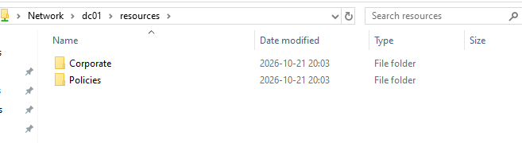
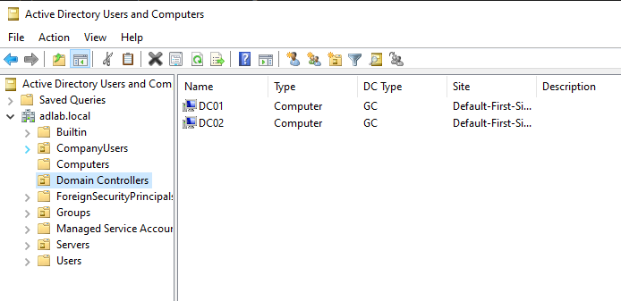

# Validation Testing

## Overview

The environment was validated to ensure RBAC, delegated administration, auditing, least privilege, separation of duties, and Active Directory redundancy functioned as designed.

---

## Test 1 - Delegated Administration

Account:

```text
ADLAB\tdavids
```

Validated:

- Delegated administration permissions
- Password reset permissions
- User management permissions within assigned scope

Expected:

Delegated administrative functions operate successfully within assigned boundaries.

Actual:

Delegated administrative functions operated as expected.

Result:

```text
PASS
```

---

## Test 2 - Administrative Boundary Enforcement

Account:

```text
ADLAB\tdavids
```

Expected:

Administrative actions outside delegated scope are denied.

Actual:

Administrative boundaries remained enforced.

Result:

```text
PASS
```

---

## Test 3 - SysAdmin Identity Administration

Account:

```text
ADLAB\aadmin
```

Validated:

- User creation
- User deletion
- Password resets
- Group management
- Role assignment

Result:

```text
PASS
```

---

## Test 4 - Privilege Escalation Prevention

Account:

```text
ADLAB\tdavids
```

Expected:

Administrative privilege escalation unsuccessful.

Actual:

Administrative boundaries remained enforced.

Result:

```text
PASS
```

---
## Access-Based Enumeration Overview

**Figure 4 - File Share Visibility Before Access-Based Enumeration**

Before Access-Based Enumeration was enabled, users could see all available shared folders regardless of whether they had permissions to access them.

Although access was still restricted by NTFS and share permissions, folder names and resource locations remained visible.

---

## Test 5 - Access-Based Enumeration (HR-Finance)


User:

```text
Helen Harper
```

Role:

```text
GG_HRFinance
```

Expected Visible Shares:

- Corporate
- HR-Finance
- Policies

Actual Visible Shares:

- Corporate
- HR-Finance
- Policies

Result:

```text
PASS
```

**Figure 5 - Access-Based Enumeration (ABE) Validation: Helen Harper**

Helen Harper (HR-Finance) can view Corporate, HR-Finance, and Policies shares based on assigned permissions.


---

## Test 6 - Access-Based Enumeration (IT Support)

User:

```text
Thomas Davids
```

Role:

```text
GG_ITSupport
```

Expected Visible Shares:

- Corporate
- Policies

Actual Visible Shares:

- Corporate
- Policies

Verification:

No visibility of:

- HR-Finance
- Logs
- Reports

Result:

```text
PASS
```

**Figure 6 - Access-Based Enumeration (ABE) Validation: Thomas Davids**

Thomas Davids (IT Support) can view Corporate and Policies shares but cannot view restricted departmental resources.



---

## Test 7 - Audit Logging

Validated Events:

```text
4624 Successful Logon
4625 Failed Logon
4720 User Created
4728 Group Membership Added
4740 Account Lockout
```

Result:

```text
PASS
```

---

## Test 8 - Active Directory Redundancy

Action:

```text
Shutdown DC01
```

Validation:

Attempt authentication while only DC02 remained online.

Expected:

Authentication remains operational.

Actual:

Authentication succeeded through DC02.

Result:

```text
PASS
```

---

## Test 9 - DNS Redundancy

Configuration:

```text
DC01 Preferred DNS → DC02
DC02 Preferred DNS → DC01
```

Action:

```text
Shutdown DC01
```

Expected:

DNS and authentication services remain available.

Actual:

Authentication and name resolution remained functional through DC02.

Result:

```text
PASS
```

---

# Infrastructure Evidence

**Figure 7 - Active Directory Redundancy**

DC01 and DC02 are present within the Domain Controllers Organizational Unit, demonstrating successful deployment of a redundant Active Directory environment.




Output of Repadmin also confirming successful replication between DC01 and DC02 by running repadmin /replsummary,


---

# Final Validation Summary

| Control | Result |
|----------|----------|
| RBAC | PASS |
| AGDLP | PASS |
| Delegated Administration | PASS |
| Least Privilege | PASS |
| Separation of Duties | PASS |
| Access-Based Enumeration | PASS |
| Audit Logging | PASS |
| Active Directory Replication | PASS |
| DNS Redundancy | PASS |
| Domain Controller Redundancy | PASS |
| Privilege Escalation Prevention | PASS |

---

## Conclusion

The environment successfully achieved all design objectives and demonstrates enterprise Identity and Access Management principles including:

- Role-Based Access Control (RBAC)
- Microsoft's AGDLP model
- Delegated Administration
- Least Privilege
- Separation of Duties
- Access-Based Enumeration (dancy

The successful DC01 failover validation further demonstrated that authentication and directory services remained available through DC02, confirming the effectiveness of the implemented redundancy and replication strategy.
